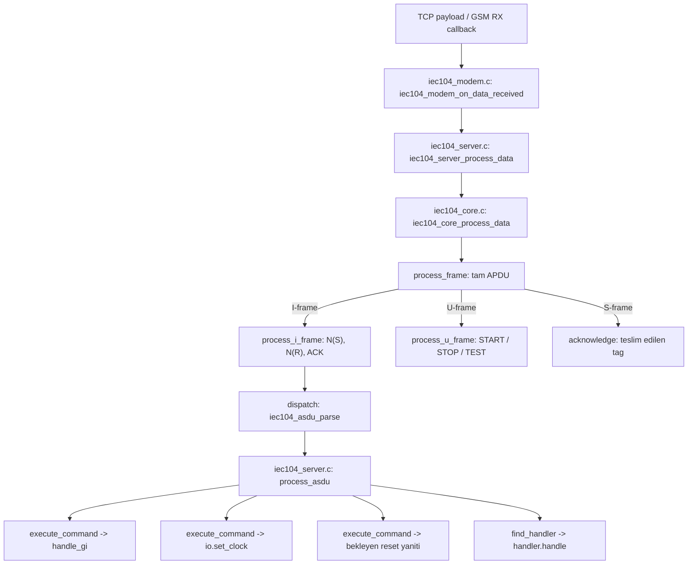
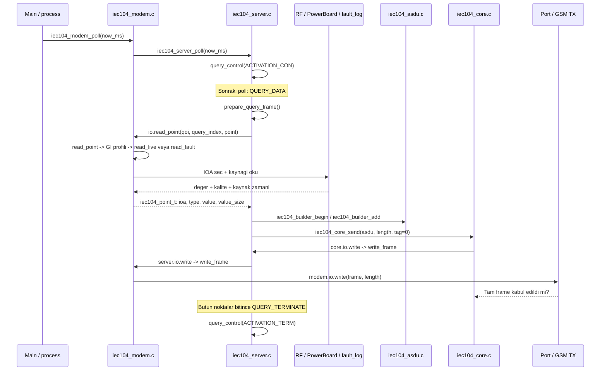

# IEC104 kütüphanesi

## Amaç

Tek TCP bağlantılı modem için sabit bellek kullanan IEC 60870-5-104 slave
(kontrol edilen istasyon) uygulamasıdır. Core, uygulama ve cihaz servisleri
ayrıdır. Kaynak kod C11'dir; heap, thread, HAL ve TCP bağımlılığı core'a girmez.

## Kullanım yeri

Bu klasör mevcut `libiec104` yanında bağımsızdır. Mevcut modem process'i,
firmware seçimi ve NVRAM düzeni bu paketle değiştirilmez. `iec104_modem.c`
ürünün RF, PowerBoard, RTC ve kalıcı olay servislerine bağlanan uygulamadır.
Host entegrasyon testi de bu dosyayı derleyip çalıştırır.

## Terimler ve roller

| Terim | Anlamı |
|---|---|
| Core | APCI, stream ayrıştırma, sıra numaraları, pencere ve timer yönetimi |
| ASDU | Uygulama verisini taşıyan protokol birimi |
| Handler | Bir komut tipini işleyen callback (geri çağırma) |
| GI | General interrogation (genel/grup sorgulama) |
| IOA / CA / OA | Nokta / istasyon / komutu başlatan taraf adresi |
| K / W | Gönderim / alım onay penceresi |
| ACK | Peer N(R) ile verilen protokol onayı |
| Backpressure | Taşımanın veya gönderim penceresinin dolu olması |

## Yapı

| Dosya | Sorumluluk |
|---|---|
| `iec104_protocol.h` | ASDU tipi, COT, QOI, APCI kontrol ve kalite sabitleri |
| `iec104_asdu.c/.h` | Açık little-endian codec, ASDU view/builder, CP56 doğrulama |
| `iec104_core.c/.h` | Tek bağlantı, START/STOP/TEST, I/S/U, ACK ve timeout |
| `iec104_server.c/.h` | GI, saat, reset, statik handler tablosu, spontane yayın |
| `iec104_modem.c/.h` | Mevcut ürün IOA'ları, RF kalite/zamanı, PowerBoard ve replay |
| `Doxyfile` | Header sözleşmelerinden HTML API belgesi |

Nesneler caller (çağıran kod) tarafından `static` olarak ayrılabilir. Global
singleton yoktur. Core ve server birden fazla nesneyle bağımsız kullanılabilir;
modem servisleri mevcut ürünün ortak RF/NVRAM/olay deposunu kullanır.

## Veri tipleri ve struct tanımları

Yeni stack'te ortak veri yapıları vardır; her ASDU tipi için ayrı bir
packed struct kullanılmaz:

| Struct | Tanım | İçerik |
|---|---|---|
| `iec104_asdu_t` | `iec104_asdu.h` | Ayrıştırılmış ASDU header'ı ve kaynak buffer'a bakan payload pointer'ı |
| `iec104_builder_t` | `iec104_asdu.h` | Wire ASDU byte'ları, kullanılan uzunluk ve nesne boyutu |
| `iec104_point_t` | `iec104_server.h` | Uygulama noktasının IOA, type, value buffer ve value_size alanları |
| `modem_live_group_t` | `iec104_modem.c` | GI grubunun alan maskesi, zaman ve akü seçimi |

`iec104_point_t.value` içinde IOA bulunmaz. IOA'yı builder ayrıca üç byte
little-endian olarak yazar; ardından `value_size` kadar veriyi kopyalar.
Bu alanın boyutları şöyledir:

| ASDU tipi | `value` içeriği | `value_size` |
|---|---|---|
| Type 1 / M_SP_NA_1 | SIQ | 1 byte |
| Type 13 / M_ME_NC_1 | float + QDS | 5 byte |
| Type 30 / M_SP_TB_1 | SIQ + CP56Time2a | 8 byte |
| Type 31 / M_DP_TB_1 | DIQ + CP56Time2a | 8 byte |
| Type 36 / M_ME_TF_1 | float + QDS + CP56Time2a | 12 byte |

Bu ürünün varsayılan GI 20 grubunda Type 13/1 kullanılır; kaynakta zaman
olsa bile cevaba eklenmez. `live_value()` zamanlı düzeni hazırlayabilir;
builder yalnız 5 veya 1 byte'lık zaman bilgisiz bölümü alır. GI 21 Type 36,
GI 22 durumları Type 30 kullanır; akü her grupta zaman bilgisiz Type 1'dir.

Eski stack'te `m_sp_na_1_t`, `m_me_nc_1_t`, `m_sp_tb_1_t`, `m_dp_tb_1_t`
ve `m_me_tf_1_t` gibi tipe özel packed tanımlar
[`libiec104/iec104_types.h`](../libiec104/iec104_types.h) içindedir.
Yeni stack bunları TCP buffer'ına cast ederek kullanmaz. Struct belleği
ile wire düzeni ayrıdır; padding, bitfield yerleşimi ve host byte sırası
frame düzenini belirlemez. Yeni stack'te tiplerin alanları açık byte
işlemleriyle okunup yazılır.

Byte offset şemaları doğrudan ilgili kodun yanında da bulunur:
`iec104_asdu_parse()` ASDU header'ını, `process_frame()` APCI/I/S/U
düzenini, `iec104_asdu_objects_valid()` SQ=0/SQ=1 nesne dizilimini,
`iec104_cp56_time_valid()` zaman bitlerini açıklar. `iec104_point_t`
yorumundaki tablo değer/kalite/zaman offset'lerini gösterir.

## Paketin izlediği yol

### TCP giriş noktası

Mevcut firmware'in listener alım yolu şöyledir:

```text
gsm_engine.c: gsm_srcev_iec104_listener_cb()
  -> at_engine_get_payload(&length)
  -> iec104_process.c: iec104_on_data(payload, length, NULL)
  -> eski libiec104: iec104_data_received()
```

Yeni kütüphaneye geçişte değişecek bağlantı, `iec104_on_data()` içindeki
son çağrıdır: payload, `iec104_modem_on_data_received(&modem, data, len, HAL_GetTick())`
ile yeni adaptöre verilir. Bu bağlantı henüz mevcut firmware'e uygulanmadı;
aşağıdaki akış yeni kütüphanenin gerçek fonksiyonlarını gösterir.



`iec104_core_process_data()` eksik TCP parçasını `core.rx` içinde tutar. Ancak tam
APDU oluşunca `process_frame()` çalışır. I-frame için sıra numaraları
doğrulandıktan sonra `dispatch()` ASDU header'ını çözer ve kayıtlı
`core.io.receive` callback'ini çağırır. Bu callback, server dosyasındaki
`process_asdu()` fonksiyonudur.

U-frame veri sağlayıcısına gitmez: `process_u_frame()` → `flush_control()`
→ `write_control()` yanıtı aynı TX callback zincirine verir. Başarılı START
ayrıca `LINK_STARTED` olayını üretir; server `link_event()` ile
`initialization_pending` ayarlar, `send_initialization()` Type 70'i yollar.
S-frame yalnız `acknowledge()` yoluna girer; ölçüm üretmez.

`process_asdu()` tip, count/SQ, COT, CA, komut IOA'sı ve test bitini
kontrol eder. GI kabul edilirse `handle_gi()` yalnız sorgu bağlamını
(`query_qoi`, `query_originator`, `query_index`, `query_state`) hazırlar.
Ölçüm verisi core içinde okunmaz.

### Callback bağlantıları nerede kuruluyor?

Dosyalarda aynı isimli private `write_frame()` ve `delivered()` fonksiyonları
vardır. Aşağıdaki tablo hangi katmanın hangisini çağırdığını ayırır.

| Kuran fonksiyon | Callback alanı | Bağlanan fonksiyon |
|---|---|---|
| `iec104_server_init()` | `core.io.receive` | `iec104_server.c: process_asdu()` |
| `iec104_server_init()` | `core.io.write` | `iec104_server.c: write_frame()` |
| `iec104_server_init()` | `core.io.delivered` | `iec104_server.c: delivered()` |
| `iec104_modem_init()` | `server.io.read_point` | `iec104_modem.c: read_point()` |
| `iec104_modem_init()` | `server.io.write` | `iec104_modem.c: write_frame()` |
| `iec104_modem_init()` | `server.io.set_clock` | `iec104_modem.c: set_clock()` → `rtc_sync()` |
| `iec104_modem_init()` | `server.io.delivered` | `iec104_modem.c: delivered()` → `iec104_event_log_mark_sent()` |
| Entegrasyonu yapan process | `modem.io.write` | Mevcut GSM TX kuyruğuna yazan port callback'i |

Context pointer da bu zincire göre kurulur: core callback'i `server`
nesnesini, server callback'i `modem` nesnesini, port callback'i ise
`iec104_modem_init()` çağrısına verilen `io.context` değerini alır.

### `iec104_core_io_t` neden var?

Bu struct core'un dışarıya çağrı yapacağı fonksiyonları ve ilgili instance
(nesne) pointer'ını bir arada tutar. Core içinde GSM, RF, NVRAM veya server
fonksiyonlarına doğrudan bağımlılık kurulmaz.

| Alan | Core için durum | Görevi |
|---|---|---|
| `context` | Callback'in ihtiyacına bağlı | Callback'e hedef nesneyi taşır; server bağlantısında `server` pointer'ıdır |
| `write` | Zorunlu | Tam APDU'yu taşıma katmanına teklif eder; kabul edilmezse core durumu ilerlemez |
| `receive` | Zorunlu | Çözülmüş ASDU'yu uygulamaya verir; server burada `process_asdu()` bağlar |
| `event` | Bare core için isteğe bağlı | START/STOP/kopuş/hata/timeout bildirir; modem hata durumunda socket kapatma işini planlar |
| `delivered` | Takip edilen yayınlar için kullanılır | Peer N(R) ile onaylanan frame'in tag'ini bildirir; modem kalıcı kaydı burada tüketir |

Buradaki `receive` TCP/UART RX callback'i değildir. Byte girişi
`iec104_modem_on_data_received()` → `iec104_core_process_data()` yoludur;
`core.io.receive` ancak frame doğrulanıp ASDU ayrıştırıldıktan sonra çağrılır.
Benzer şekilde `write=true` taşımanın kabulüdür; `delivered(tag)` ise SCADA
ACK'sidir. Kalıcı olay kaydını güvenle tüketmek için bu ayrım gerekir.

Yapı teknik olarak doğrudan fonksiyon çağrılarıyla değiştirilebilir; o durumda
core belirli uygulama/taşıma fonksiyonlarını tanımak zorunda kalır. Mevcut
yapının somut faydası, aynı core kodunun modem taşımasıyla ve test transport'u
ile çalışması, gönderim reddinin sınanabilmesi ve bağlamın global singleton
yerine her core nesnesine bağlı olmasıdır. Bu, yeni bir tampon/kuyruk/thread
katmanı değildir; yalnız callback ve context pointer'larıdır. Modem normal
kullanımında bu tabloyu `iec104_server_init()` kurar; uygulamanın her pakette
yeniden oluşturması gerekmez.

### GI isteği nasıl gerçek veriyle doluyor?



Her poll bütün sorguyu bitirmek zorunda değildir. `prepare_query_frame()`
en çok 32 nokta okur; aynı type ve value_size değerine sahip noktaları bir
ASDU'ya toplar. Type değişince veya frame dolunca mevcut ASDU gönderilir.
Kaynak `IEC104_POINT_SKIP` döndürürse nokta atlanır; `END` sorguyu bitirir;
`ERROR` başarılı ACT_TERM yerine bağlantı kapatma isteği üretir.

`read_live()` değerleri `rf_get_phase_data()` ile alır; `live_value()` float,
kalite ve CP56 alanlarını `point.value` içine yazar. Akü noktası
`battery_warning()` → `power_board_get_snapshot()` yolundadır.
`read_fault()` ise `fault_log_read_nth()` ile kayıt okur; `fault_value()`
akım/süre/enerji/yük alanlarını doldurur. ASDU builder'a verilen gerçek
değeri taşıyan nesne **`iec104_point_t`**'dir.

### Hazırlanan ASDU nasıl TCP frame oluyor?

```text
iec104_builder_begin()     -> type, VSQ, COT, OA, CA header'i
iec104_builder_add()       -> 3-byte IOA + point.value byte'lari
iec104_core_send()         -> 68, length, N(S), N(R) + ASDU
server.c: write_frame()    -> server.io.write
modem.c: write_frame()     -> modem.io.write
port callback'i           -> GSM TX slotuna tam frame kopyasi
iec104_tx_process()        -> gsm_send_to_socket(...IEC104_SOCKET...)
```

Son iki adım mevcut taşıma koduyla entegrasyon sınırıdır. `iec104_core_send()`
callback'ten `true` alınca frame'i kabul edilmiş sayar ve N(S)'yi ilerletir.
K doluysa veya port `false` döndürürse hazırlanmış GI ASDU'su saklanır;
sonraki poll aynı ASDU'yu dener. TCP'ye kabul ile SCADA'nın ACK vermesi
ayrı aşamalardır; ACK ayrıntıları **ACK ve timer akışı** bölümündedir.

## IOA kaynağı ve istek çözümleme

### GI'de gelen IOA ile cevap IOA'ları aynı iş değil

GI komutu `C_IC_NA_1` (100), IOA=0 ve QOI=20..24 ile gelir. IOA=0 bir
ölçüm adresi değildir; sorgu komutunun adresidir. `process_asdu()` bunu
kontrol eder, `handle_gi()` grubu seçer. Cevap noktalarının IOA'ları istekten
kopyalanmaz; aşağıdaki yapılandırmadan okunur.

Bu profilde tek IOA için read komutu (`C_RD_NA_1`, 102) handler'ı yoktur.
Dolayısıyla gelen herhangi bir IOA'yı ölçüme çeviren genel bir lookup
(adres arama) tablosu bulunmaz. Böyle bir komut eklenecekse **Yeni tip veya
handler ekleme** bölümündeki extension sınırı kullanılır.

### Application hangi IOA'yı nereden alıyor?

| Nokta | IOA kaynağı | Değer kaynağı |
|---|---|---|
| Anlık akım | `line->iec104.anlik_akim[phase]` | RF cache: `live.current_amps` |
| Enerji | `line->iec104.enerji_varyok[phase]` | RF cache: `live.flags` bit 0 |
| Yük | `line->iec104.yuk_akimi_varyok[phase]` | RF cache: `live.flags` bit 1 |
| RF haberleşme | `line->iec104.rf_haberlesme_varyok[phase]` | RF cache: `is_online` |
| Trip-failure | `line->iec104.trip_failed[phase]` | RF cache: `trip_failed` |
| Akü | `nvram_get_iec104_config()->ioa_aku_uyarisi` | PowerBoard alarm özeti |
| Reset komut adresi | `nvram_get_iec104_config()->ioa_modem_reset` | Gelen komut IOA'sı ile karşılaştırma |
| Geçici/kalıcı arıza | `line->iec104.temporary_fault/permanent_fault` tabanı + mevcut IOA yardımcıları | `fault_log_read_nth()` |

Buradaki `line`, `breaker_get_power_line_by_idx(feeder)` sonucudur.
`breaker.c` bu pointer'ı `nvram_get_breaker_rw()->line[feeder]` içinden
verir. Yani IOA'lar NVRAM'in RAM'deki yapılandırma görüntüsünden gelir;
core içine sabit adres yazılmaz. Global akü/reset IOA'ları init sırasında
adaptöre alınır; satır IOA'ları nokta okunurken mevcut yapıdan alınır.
Yapılandırma değişikliği zamanı **Modeme bağlama** bölümünde tanımlıdır.

### Flash'tan RAM'e yükleme nerede yapılıyor?

`nvram.c` içindeki `static nvram_t nvram` uygulamanın RAM görüntüsüdür.
Açılışta `nvram_init()` ana ve yedek slotu `nvram_validate_slot()` ile
header, şema ve CRC açısından doğrular. Geçerli slotlar arasından sequence
değerine göre güncel görüntüyü seçer ve şu çağrıyla RAM'e yükler:

```c
w25qxx_read_buff(nvram_slot_addr[load_slot], &nvram, sizeof(nvram));
```

Geçerli slot bulunamazsa mevcut defaults yolu kullanılır. IEC104 sorgusu
geldiğinde tekrar Flash okuması yapılmaz; çağrı zinciri şöyledir:

```text
Acilis:
nvram_init -> nvram_validate_slot -> w25qxx_read_buff -> RAM: nvram

Canli IOA:
read_live -> breaker_get_power_line_by_idx(feeder)
          -> nvram_get_breaker_rw() -> &nvram.breaker
          -> line[feeder].iec104.anlik_akim[phase]  (ornek alan)
          -> live_ioa -> iec104_ioa_3byte_to_uint32 -> point.ioa

Ariza IOA:
fault_ioa -> secilen iec104_get_feeder_*_ioa yardimcisi
          -> nvram_get_breaker_rw() -> nvram.breaker.line[feeder].iec104
          -> temporary_fault/permanent_fault tabani + fider/faz/kayit/alan ofseti

Global IOA:
iec104_modem_init -> nvram_get_iec104_config() -> &nvram.iec104_config
                 -> ioa_aku_uyarisi / ioa_modem_reset
```

`nvram_get_breaker_rw()` ve `nvram_get_iec104_config()` birer pointer
döndürür; kendi başlarına Flash I/O yapmaz. `iec104_ioa_3byte_to_uint32()`
da yalnız üç adres byte'ını sayıya çevirir. IOA okuması ile ölçüm/arıza
değerinin okunması ayrıdır; arıza verisi için `fault_log_read_nth()` yine
kendi depolama servisini kullanır.

### Canlı veri için somut GI 21 örneği

Örnek yapılandırmada Fider 2 / L3 akım IOA'sı 112 olsun. Fider ve faz
indeksleri sıfırdan başlar: `feeder=1`, `phase=2`.

```text
Gelen: type=C_IC_NA_1(100), COT=ACTIVATION(6), IOA=0, QOI=GROUP_1(21)
process_asdu -> execute_command -> handle_gi
query_index=5 -> field=CURRENT, feeder=1, phase=2
read_live -> breaker_get_power_line_by_idx(1)
live_ioa -> line->iec104.anlik_akim[2] -> IOA=112
rf_get_phase_data(1, L3, now_ms, &data)
live_value -> point.value: float(4) + QDS(1) + CP56(7)
point = {ioa=112, type=M_ME_TF_1(36), value_size=12, value=...}
prepare_query_frame -> iec104_builder_add(112, point.value)
iec104_core_send -> I-frame: COT=21, OA=istegin OA'si, CA=yapilandirilmis istasyon
```

`query_index` bir IOA değildir; dolaşım konumudur. `read_live()` bunu
`field = index / (7*3)`, `feeder = (index/3) % 7`, `phase = index % 3`
ile çözer. Kodda 7/3 yerine `MAX_POWER_LINE_COUNT/PHASE_MAX` kullanılır.
Alan sırası `modem_live_field_t` enum'undadır. Varsayılan `gi_live_groups`
tablosunda GI 21 akım dışındaki alanları atlar; GI 22 akımı atlar;
GI 20 bütün canlı kategorileri seçer.

### Arıza listesi IOA hesabı

`read_fault()` konumu fider, faz, kayıt ve alana ayırır. Her fazda 15
kayıt, her kayıtta dört alan vardır. Kayıt 0 en yenidir. `fault_ioa()`
alan adına göre `iec104_get_feeder_temporary_fault_*_ioa()` veya
`iec104_get_feeder_permanent_fault_*_ioa()` fonksiyonunu seçer. Bu gerçek
hesaplar [mevcut config kodundadır](../libiec104/iec104_config.c).

```text
adres = ilgili_fiderin_yapilandirilmis_tabani
      + feeder * (15 * 4 * PHASE_MAX)
      + phase  * (15 * 4)
      + record * 4
      + field
```

Alanlar: CURRENT=0, DURATION=1, ENERGY=2, LOAD=3; kodda
`modem_fault_field_t` kullanılır. Örneğin taban 2000, feeder=1, phase=2,
record=3 ve ENERGY alanı için adres `2000+180+120+12+2=2314` olur.
2000 yalnız örnek tabandır; gerçek değer NVRAM'den gelir. Formüldeki
fider ofseti mevcut yardımcıların davranışıdır; adaptör ikinci kez eklemez.
Kapalı fider ve taban IOA=0 sorguda atlanır.

### Reset ve saat komutunun IOA yolu

Reset: `iec104_modem_init()` yapılandırılmış reset IOA'sını
`server.config.reset_ioa` alanına koyar. `process_asdu()` gelen IOA'yı
`iec104_read_ioa()` ile çözer; 0 veya bu adrese eşitse QRP kontrolüne
geçer. Pozitif yanıt kabul edildikten sonra `iec104_server_poll()` →
`modem.c: request_reset()` → `modem.io.request_reset` çağrılır.
Adres uyuşmazsa COT `UNKNOWN_IOA` (47) olur ve reset yürütülmez.

Saat: aynı çözümleme yolunda yalnız IOA=0 kabul edilir. Geçerli CP56 için
`execute_command()` → `modem.c: set_clock()` → `rtc_sync()` çağrılır;
sonuç pozitif/negatif ACT_CON'u belirler.

## Spontane olayın ve ACK'nin yolu

```text
RF ureticisi: olay kaydini mevcut gunluge ekle + sync
  -> iec104_modem_notify_event()
  -> iec104_modem_poll() -> replay()
  -> iec104_event_log_read_newest_unsent()
  -> replay_points() -> fault_ioa/fault_value veya alarm IOA'si
  -> iec104_server_publish() -> builder -> iec104_core_send(tag)
  -> port/GSM TX -> SCADA

SCADA ACK: S-frame veya I-frame N(R)
  -> core: acknowledge()
  -> server.c: delivered(tag)
  -> modem.c: delivered(tag)
  -> iec104_event_log_mark_sent(sequence)
```

Arıza kaydının iki frame'inden yalnız sonuncusu teslim tag'i taşır.
`replay_points()` burada liste kaydı 0'ın IOA alanlarını kullanır; değerler
canlı listeden yeniden okunmaz, `replay_record` içindeki kalıcı olaydan gelir.
Akü değişimi, ilk RF/trip-failure snapshot'ı ve periyodik yayın da
`iec104_server_publish()` ile aynı gönderim yoluna bağlanır. Bunlar ACK ile silinecek
kalıcı kayıt taşımadıkları için tag=0 kullanır.

## Sayısal değerleri kodda bulma

Wire değerlerinin adları `iec104_protocol.h` içindedir. Örnekler:
`IEC104_CONTROL_STARTDT_ACT=0x07`, `IEC104_TYPE_C_IC_NA_1=100`,
`IEC104_COT_ACTIVATION_CON=7`, `IEC104_QOI_GROUP_1=21`.
Core kontrol switch'i bu adları kullanır. Modem `live_ioa()` switch'i ise
`MODEM_LIVE_CURRENT/ENERGY/LOAD/RF/TRIP_FAILED` alan adlarıyla çalışır.
Arıza alanları `MODEM_FAULT_CURRENT/DURATION/ENERGY/LOAD` ile gösterilir.

`spontaneous_live_group` spontane yayın için ayrı, zaman damgalı bir
profildir. GI tablosuna dahil değildir; yapay QOI değeri kullanılmaz.
Golden testlerin beklenen byte dizileri bağımsız karşılaştırma için
sayısal kalır.

## Protokol profili

COT iki, CA iki, IOA üç byte'tır. APDU en çok 255, ASDU en çok 249 byte'tır.
Wire üzerinde C struct veya bitfield kopyalanmaz. Float IEEE754 binary32'dir.

| İşlem | Ürün davranışı |
|---|---|
| GI 20 | Type 13 akımlar, Type 1 durumlar ve akü |
| GI 21 | Type 36 akımlar; saklanmış RTU alım zamanı |
| GI 22 | Type 30 enerji/yük/RF/trip-failure; Type 1 akü |
| GI 23 / 24 | Geçici / kalıcı listeler; Type 36 ve Type 30 |
| Type 70 | Her TCP oturumunda ilk başarılı START sonrası bir kez |
| Type 103 | IOA=0; geçerli CP56 ve başarılı `rtc_sync` ile pozitif onay |
| Type 105 | IOA=0 veya mevcut ModemReset IOA; QRP=1 gecikmeli reset |
| QRP=2 | Negatif ACT_CON; depo silinmez |
| Type 45 / 46 | Varsayılan handler yoktur; unknown-type negatif yanıt |
| Test bitli komut | Negatif ACT_CON; saat/reset yan etkisi yoktur |
| Hatalı COT / CA / IOA | Negatif COT 45 / 46 / 47 |
| Bilinmeyen tip | Negatif COT 44; gelen payload korunur |

Komut yanıtları ve GI verileri istek OA'sını, spontane yayın kendi OA'sını
kullanır. GI sürerken ikinci GI negatif yanıt alır; ilk sorgu korunur.
Hatalı uzunluk/count/SQ veya sıra numarası oturumu kapatır. Geçersiz stream
içinde yeni başlangıç byte'ı arayarak komut yürütmeye devam edilmez.

## Sahiplik ve taşıma kuralları

1. Bir nesneye bütün erişimler aynı main/process bağlamından yapılmalıdır.
   ISR içinden erişilmemelidir. Callback içinden aynı nesneye tekrar
   `process_data/on_data_received/poll/send/open/close` çağrılmamalıdır.
2. `write` yalnız frame'in tamamı sıralı biçimde kopyalandığında `true`
   döndürmelidir. `false` sıfır byte kabul edildiği anlamına gelmelidir.
   Kısmi socket yazıları taşıma katmanında tamamlanmalıdır.
3. Callback pointer'ları saklanmamalıdır. Kalıcı bağlam ve handler tabloları
   server nesnesinden uzun yaşamalıdır. `receive` içindeki ASDU view yalnız
   callback boyunca kullanılmalıdır.
4. `open` gerçek TCP açılışında, `close` gerçek socket kapanışında
   çağrılmalıdır. STARTDT aynı TCP'deki sekansları sıfırlamamalıdır.
5. `on_data_received/process_data` dönüş değeri kontrol edilmelidir. Açık bağlantıda tüketilmeyen
   suffix (kalan veri) tutulup tekrar verilmelidir. Core'un doğrudan
   `receive=false` kullanan tüketicisi bu akış kontrolünü sağlamalıdır.
   Ürün server'ı ASDU'yu senkron olarak alır; kapandıktan sonraki TCP
   verisi işlenmez.
6. Core error/timeout/application-error olayında socket kapatma işi
   callback tarafından planlanmalıdır. Callback içinde session API'sine
   yeniden girilmemelidir. Dış taşıma kuyruğu socket kapanışında
   temizlenmelidir; eski frame yeni bağlantıya aktarılmamalıdır.
7. Monotonic millisecond değeri kullanılmalıdır. Timer aralıkları
   `1..INT32_MAX` içinde kalmalıdır. Poll en kısa timer'dan daha sık
   çağrılmalıdır. `uint32_t` tick taşması desteklenir.

Server yalnız bir bekleyen komut yanıtı tutar. Bu yanıt backpressure yüzünden
beklerken yeni komut gelirse oturum kapatılır; ikinci komut yürütülmez.
Bu, sınırsız komut kuyruğunu ve bir I-frame arkasındaki ACK'nin bekletilmesini
önleyen açık kapasite sınırıdır. SCADA onay bekleyerek komut göndermelidir.
Pencere müsaitken aynı TCP parçasındaki birden fazla komut desteklenir.

## ACK ve timer akışı

Gönderim kabul edilmeden N(S) ve teslimat bilgisi ilerlemez. GI için okunan
noktalar tek hazırlanmış ASDU'da tutulur; reddedilen ASDU atlanmaz veya
yeniden örneklenmez. Okuma konumu bu hazırlanmış ASDU'nun sonrasını gösterir.
TCP yeniden gönderimi TCP'ye aittir; core ikinci bir retransmit kuyruğu tutmaz.
Her bekleyen I-frame için yalnız gönderim zamanı ve caller tag saklanır.
Kısmi ACK, kalan en eski frame'in t1 başlangıcını değiştirmez. Eski ACK tekrar
teslim callback'i üretmez; gönderilmemiş veriyi onaylayan ileri ACK kapatır.

STOP yeni I-frame çıkışını durdurur. Bekleyen ACK'ler ve t1 takibi sürer.
Gerekli S-ACK çıktıktan ve bütün I-frame'ler onaylandıktan sonra STOP_CON
gönderilir. START aynı TCP oturumunu devam ettirir. Gönderilemeyen U/S
yanıtları poll'da tekrar denenir; sonsuza kadar hazır görünmez.

| Timer | Başlangıç ve sonuç |
|---|---|
| t0 | TCP listener'a aittir; core socket açmaz |
| t1 | En eski I-frame, bekleyen TEST_CON veya gönderilemeyen kontrol yanıtı |
| t2 | İlk onaysız alınan I-frame; W dolarsa daha erken S-ACK |
| t3 | Son tam alınan/gönderilen frame; dolunca TEST_ACT |

Modem adaptörü mevcut karar gereği NVRAM t3 değerine iki saniye ekler.
Genel core, caller'ın verdiği t3'ü değiştirmez. TLS, çoklu master ve fiziksel
açma/kapama/SBO bu ürün profilinin parçası değildir.

## Modeme bağlama

1. CubeIDE source/include kapsamına bu klasördeki dört `.c` dosyası ve
   klasör eklenir. Generated `Release/*/subdir.mk` dosyaları elle değiştirilmez.
2. Mevcut `iec104_config.c`, `iec104_util.c`, `cp56time2a.c`, olay günlüğü,
   fault log, RF, PowerBoard ve RTC servisleri korunur. Eski protokol core'u
   ve eski IEC process/replay üreticileriyle aynı socket eşzamanlı sürülmez.
3. NVRAM ve servislerden sonra statik `iec104_modem_t` ile
   `iec104_modem_init()` çağrılır. Başarısız init hazır sayılmaz.
4. `io.write`, mevcut `iec104_process.c` slot gönderiminin tam-frame kabul
   sözleşmesine bağlanır: eski `iec104_send(frame, (uint16_t)length) == 0`.
   Frame en çok 255 byte olduğundan sınırdaki dönüşüm güvenlidir.
5. GSM listener açılış/kapanışında `iec104_modem_open/close`, RX callback'inde
   `iec104_modem_on_data_received`, mevcut periyodik process'te `iec104_modem_poll`
   çağrılır. Tick ayrıca saniyelik artırılmaz; `HAL_GetTick()` verilir.
6. `request_close` mevcut listener close olayını, `request_reset` mevcut
   3 saniye flush + 2 saniye close/reboot process'ini planlar. Callback'in
   içinde fiziksel reset yapılmaz.
7. `rf_events.c` ve `rf_alarm.c` kalıcı kaydı ekleyip sync ettikten sonra
   eski `iec104_replay_send_record` yerine `iec104_modem_notify_event`
   çağırır. Veri tekrar kopyalanmaz; adaptör mevcut unsent günlüğünü okur.
8. Yapılandırma bağlı oturumda değiştirilmez. Listener kapandıktan sonra
   mevcut config uygulama yolundan yeniden init edilir.

Bu adımlar entegrasyon tarifidir; mevcut çalışan firmware'e uygulanmamıştır.
Yeni adaptörün ARM object derlemesi ve host TCP testleri fiziksel cihazda
GSM taşıması, reset gecikmesi veya enerji kesintisi testi yerine geçmez.

## Ürün verisi ve replay

Canlı akım/enerji/yük/RF kalitesi mevcut `rf_get_phase_data` kaynağındandır.
Ölçüm IV/NT ile iletişim durumu birbirinden ayrıdır. Timestamp yeniden
üretilmez; RTU alım zamanı kullanılır. Henüz LIVE almamış latched trip-failure
mevcut ürün davranışıyla RTC zamanı üzerinden sunulur.

Akü, mevcut PowerBoard alarm kümesinin tek bit özetidir. Summary/alarm
geçerliliği yoksa IV=1 olur. BMS reader açılmaz. İlk değer ve SIQ değişikliği
spontane gönderilir. START sonrası RF/trip-failure için 42 noktalı snapshot
vardır. Periyodik yayın akım, enerji, yük ve RF kategorilerini kapsar;
NVRAM interval=0 ise kapalıdır. IOA=0 veya kapalı fider atlanır.

Liste IOA hesapları mevcut `iec104_config.c` yardımcılarıyla aynıdır.
Arıza akımı `fault_log_current_amps()` ile amper, süre mevcut sözleşmedeki
millisecond float olarak gönderilir. Liste identity/okuma hatası başarılı
ACT_TERM ile örtülmez; socket kapatma istenir.

Replay mevcut kalıcı günlüğü en yeniden eskiye okur. GI 23/24 tamamlanınca,
START'tan 15 saniye sonra veya yeni canlı olay bildirimiyle başlar. Aynı anda
bir kayıt tutulur. Arıza iki ASDU'dur: iki Type 36, ardından iki Type 30.
K=1 iken ikinci ASDU sonraki pencereye kalır. Sadece son ASDU'nun ACK tag'i
`mark_sent` çağırır. Kopuşta kayıt unsent kalır ve sync denenir. Batch bitişinde
başarısız sync sonraki poll'da tekrar denenir; teslimat en az bir kezdir.
Kapalı/atansız IOA'ya sahip kayıt teslim edilmiş sayılmaz; kalıcı olarak
beklemeye devam eder. Daha eski kayıtları geçme politikası eklenmemiştir.

GI listeleri mevcut servis üzerinden ordinal (sıralı konum) okumasıdır;
flash snapshot alınmaz. Sorgu sırasında listeyi değiştiren üreticiler mevcut
üründe olduğu gibi serialize edilmelidir. Taşıma tıkanırken hazırlanmış ASDU
korunur. Bütün sorguya ait tarihsel depo görüntüsü garantisi verilmez.

## GI 20/21/22 içeriğini değiştirme

Type 100 komutunu kabul eden ortak handler, server'daki `process_asdu()` →
`handle_gi()` yoludur. Modem tarafında `read_point()` gruba göre veri
sağlayıcısını seçer. GI 20 için ayrıca aynı ACT_CON/ACT_TERM kodunu
tekrarlayan bir komut handler'ı yoktur; bu protokol akışı ortaktır.

Canlı grup içerikleri `iec104_modem.c` içindeki **`gi_live_groups[]`**
tablosunda tanımlıdır. `read_point()` tablodaki QOI'yi bulur ve seçilen
profili `read_live()` fonksiyonuna verir.

| QOI | `fields` | `with_time` | `include_battery` |
|---|---|---|---|
| GI 20 / STATION | `MODEM_FIELDS_ALL` | false | true |
| GI 21 / GROUP_1 | `MODEM_FIELDS_CURRENT` | true | false |
| GI 22 / GROUP_2 | `MODEM_FIELDS_STATUS` | true | true |

`fields`, mevcut veri kategorilerini seçen bit maskesidir. Kullanılabilir
alanlar `CURRENT`, `ENERGY`, `LOAD`, `RF`, `TRIP_FAILED` adlarını taşır.
`STATUS`, akım dışındaki dört kategorinin; `ALL`, beş kategorinin birleşimidir.
`with_time` akım için Type 13/36, durum için Type 1/30 seçimini belirler.
Akü kendi sözleşmesi gereği bu flag'den bağımsız, her zaman Type 1'dir.

Örnek: GI 21'e mevcut enerji noktaları da dahil edilecekse yalnız ilgili
tablo satırı aşağıdaki gibi değiştirilir:

```c
{.qoi = IEC104_QOI_GROUP_1,
 .fields = MODEM_FIELDS_CURRENT | MODEM_FIELDS_ENERGY,
 .with_time = true, .include_battery = false},
```

Bu seçim akımı Type 36, enerjiyi Type 30 olarak üretir. Değer, kalite, IOA
ve kaynak zamanı mevcut okuyuculardan gelir. Core, handler yönlendirmesi,
paket oluşturma, ACK ve K=1 devam akışı değiştirilmez. Bu örnek rehber içindir;
çalışan varsayılan GI 21 hâlâ yalnız akımdır.

GI 22'den RF çıkarılacaksa `fields` değeri
`MODEM_FIELDS_ENERGY | MODEM_FIELDS_LOAD | MODEM_FIELDS_TRIP_FAILED`
yapılır. Akü eklemek/çıkarmak için `include_battery` değiştirilir.
Sorgudan bir alanı çıkarmak, spontane/periyodik yayın profilini değiştirmez.

GI 23/24 `read_point()` içinde `read_fault()` yoluna yönlenir; burada
`fault_ioa()` adresi, `fault_value()` kayıt alanını seçer. Canlı grup tablosu
arıza listelerinin içeriğini değiştirmez. Bunların adres hesabı **Arıza
listesi IOA hesabı** bölümündedir.

Tamamen yeni bir veri kategorisi eklenecekse yalnız maske yeterli değildir.
Önce modem katmanında bu noktanın IOA, type, value_size, değer, kalite ve
zamanını üreten okuma kodu eklenir (`live_ioa/live_value/read_live` veya
`read_point()` içindeki yeni sağlayıcı). Sonra uygun grup maskesine alınır.
Yeni ASDU komutu eklemek ise aşağıdaki handler tablosunun işidir; GI grubuna
mevcut kategori eklemek için yeni ASDU handler'ı gerekmez.

İçerik değişikliğinde Ceedling golden/IOA testleri ile Python SCADA tarafındaki
beklenen IOA kümeleri birlikte güncellenmelidir. Ham TCP frame'leri doğrudan
GI sağlayıcısından gönderilmemelidir; sağlayıcı `iec104_point_t` döndürmeli,
frame/ACK yönetimi server/core katmanında kalmalıdır.

## Yeni tip veya handler ekleme

Yeni monitor tipi için `iec104_point_t` içinde type, IOA, wire value ve
value_size sağlanır. Server aynı tip/boyuttaki noktaları ASDU sınırına kadar
birleştirir. Mevcut ürün point payload sınırı 12 byte'tır. Daha büyük tip
için bu sabit ve ilgili testler değiştirilir veya genel builder/core API'si
kullanılır. Core'un state machine'i değiştirilmez.

Yeni komut tipi için statik `iec104_handler_t` tablosuna type, IOA hariç
value_size ve handler eklenir. `server_config.handlers/handler_count` tabloyu
gösterir. Builtin 100/103/105 ve aynı type'ın ikinci kaydı kabul edilmez.
Handler isteğin count/SQ/IOA anlamını kontrol eder, bir response builder
hazırlar ve `true` döndürür. `false` negatif ACT_CON üretir. Ortak CA/COT,
payload uzunluğu ve test-bit kontrolleri handler'dan önce yapılır.

Örnek gerçek handler ve tam-frame kontrolleri:
[`test_iec104_stack.c`](../../test/iec104/test_iec104_stack.c).
Sadece yeni tipin test/codec kodu ve handler tablosu eklenir; core'a switch
dalı eklemek gerekmez. Çok aşamalı bir komut için handler özel durumu kendi
uygulama bağlamında tutmalıdır; core'a ürün durumu eklenmemelidir.

## Testler

Repo kökünden:

```powershell
cd test
ceedling test:pattern[iec104_stack]
cd ..
python test/integration/iec104_stack/run_tests.py
python test/integration/iec104_stack/check_arm.py --compiler <arm-none-eabi-gcc>
```

Ceedling fixture yalnız transport, RF/PowerBoard, RTC ve depolama sınırlarını
değiştirir. Core/server/modem ve eski IOA hesapları gerçek C dosyalarıdır.
Golden vektörler Type 1/13/30/31/36 için tekli ve çoklu tam APDU byte'larını
sabit değerlerle karşılaştırır; serializer çıktısından türetilmez.

TCP testinde aynı üretim C dosyaları native shared library olarak derlenir.
Python yalnız socket taşır; SCADA tarafı `c104==2.2.1` üzerinden lib60870'dir.
Mevcut `test/system/iec104_master/.venv` varsa kullanılır; yoksa
`test/integration/iec104_stack/requirements.txt` kurulu Python kullanılmalıdır.
Eksik c104 veya compiler sessizce SKIP edilmez, test başarısız olur.
Merkezi `test/run_all.rb all/integration/critical` paketi bu testi içerir.

Coverage için:

```powershell
cd test
ceedling gcov:pattern[iec104_stack]
```

ARM kontrolü Release include/define ayarlarını okur; dört yeni modülü
strict C11/Werror ile derler. Eski bağımlılık header'ları GNU macro içerdiği
için system include olarak alınır; yeni kaynaklarda uyarı istisnası yoktur.
Heap/atomic runtime sembolleri ve fonksiyon stack kullanım çıktıları kontrol
edilir. Bu komut firmware yüklemez veya linker düzenini değiştirmez.

## Kod yazım formatı

Bu klasördeki C/header dosyalarının formatı `.clang-format` içindedir.
26.10.2026 tarihli kullanıcı düzenlemesindeki `fault_ioa()` örneği esas
alınır: dört boşluk, Allman fonksiyon/control blokları, hizalı atamalar ve
tek satırda okunabilen tablo elemanları kullanılır. Satırlar sırf 80 sütuna
uymak için bölünmez; formatter 120 sütunda uzun ifadeleri düzenler.
Devam satırları ilk argümanın veya ifadenin başlangıcıyla hizalanır;
satır başından sabit bir ek girinti verilmez. 120 sütun ve hizalama tercihi
repo talimatlarında da geçerlidir; bu değişiklikte yalnız yeni IEC104
klasörü yeniden formatlanır. Eski stack ve diğer modüller topluca değiştirilmez.

Klasör içinde örnek kullanım:

```text
clang-format -i iec104_modem.c
```

## Doxygen

Klasör içinde `doxygen Doxyfile` çalıştırılır. Çıktı repo altındaki
`test/build/iec104-stack/doxygen` klasöründedir. API sözleşmeleri header'larda,
kritik timer/ACK/yan etki açıklamaları ilgili kaynakta tutulur.
Önemli public API'lerde `@brief`, `@param`, `@return`, `@pre` ve `@note`
açıklamaları bulunur. GI hazırlama, nokta okuma, IOA seçimi, replay ve ACK
gibi private fonksiyonların açıklamaları tanımlarının hemen üzerindedir.

## Referans ve lisans sınırı

Ana davranış referansı [MZ Automation lib60870](https://github.com/mz-automation/lib60870),
özellikle [cs104_slave.c](https://github.com/mz-automation/lib60870/blob/master/lib60870-C/src/iec60870/cs104/cs104_slave.c)
START/STOP/sequence/timer akışıdır. Kontrol tarihi 25.10.2026'dır.
Yerel protokol kaynağı repo köküne göre
`../iec104/docs/IEC60870-5-104_Referans.md`
(bu reponun kardeş `iec104` deposu), ürün sözleşmesi ise
[`IEC104 rehberi`](../../doc/IEC104_YAPILANDIRMA_VE_ADRES_REHBERI.md) içindedir.
Yeni core bu ürün profili için bağımsız yazılmıştır; upstream kaynak kodu
kopyalanmamıştır. Test bağımlılığı c104/lib60870'nin lisansı kendi paketine aittir.

## Değişiklik geçmişi

| Tarih | Değişiklik |
|---|---|
| 25.10.2026 | Bağımsız core, server, modem adaptörü ve merkezi test paketi |
| 26.10.2026 | Fonksiyon bazlı TCP/veri/IOA/ACK akışları ve adlandırılmış protokol/alan sabitleri |
| 26.10.2026 | ASDU ve veri giriş API adları; GI 20/21/22 için ortak içerik tablosu |
| 26.10.2026 | GI zaman seçimi ve struct/wire ayrımı için kod yorumları ve veri tipi tablosu |
| 26.10.2026 | Kullanıcının fault_ioa formatı, yerel clang-format ayarı ve Flash/RAM IOA okuma zinciri |
| 26.10.2026 | Ayrıştırma/oluşturma noktalarında APCI, ASDU, komut ve veri tipi byte/bit şemaları |
| 26.10.2026 | Önemli fonksiyonlarda Doxygen sözleşmeleri ve core callback tablosunun amacı |
